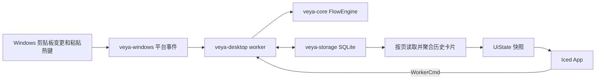

# Veya 架构与职责

本文描述当前 Windows 版的运行结构。功能状态以代码和 [README](../README.md) 为准；文件、图片和固定记录的设计与验收记录在 `.scratch/veya-history-v0.2/`。

## 数据流

1. `veya-windows/src/platform/` 的 Win32 消息循环发出 `PlatformEvent`。剪贴板信号包含内容及来源线索；低级键盘钩子发出粘贴触发线索；同一消息线程注册全局窗口快捷键，并在 `WM_HOTKEY` 到来时采样主窗口是否可见且未最小化。`enrich_clipboard`、`enrich_paste` 补充进程名、窗口名和时间信息。
2. `veya-desktop/src/worker.rs` 独占运行中的 `FlowEngine` 和事件写入使用的 `Store`：`FlowEngine` 只保留当前粘贴关联所需的活跃记录，完整历史保存在 SQLite。worker 处理平台事件和 `WorkerCmd`，把变化写回 SQLite。粘贴触发只通过 `Store::append_paste` 追加本次使用线索，不重写载荷和既有线索；数据库写入成功后才更新 core，失败向 UI 报告并保留原内存状态，不自动重试。私有 `history_loader.rs` 后台线程持有独立的 `Store` 连接，按 `(created_at_ms, sequence)` 游标分批读取轻量历史投影，用 core 有序聚合器逐组筛选，每次只发布一页卡片。搜索、分类、固定筛选和排序仍应用于完整历史。追踪开关的 UI 请求带序号；快照回传已处理的序号，避免定时同步把刚点击的状态短暂覆盖为旧值。
3. `veya-desktop/src/app.rs` 的 Iced `App` 在 `Tick` 中读取快照并集中处理消息；`app/history.rs`、`app/detail.rs` 和 `app/settings.rs` 分别渲染历史、详情/完整内容弹窗和设置。`app/tracking.rs` 保存追踪开关尚未确认的请求，并用 worker 快照序号完成确认。复制、删除、排除应用等动作通过 `WorkerCmd` 发给 worker。
4. `veya-desktop/src/main.rs` 在单例门禁和键盘钩子启动前，通过 `veya-windows/src/platform/elevation.rs` 检查安装器继承的管理员权限，并尝试用 Explorer 用户令牌重新启动。之后负责单例门禁、字体和 Iced 窗口装配。第二次启动通过 `veya-windows/src/platform/singleton.rs` 通知已有实例。热键默认打开 `app/quick.rs` 的快捷粘贴面板，并在平台消息线程中立即采样外部目标 HWND/PID/TID；再次按热键可收起可见面板。托盘、单例通知和面板的“管理历史”打开完整窗口。热键注册状态由 worker 发布到设置页。

## 模块职责与接口

| 模块 | 当前接口和所有权 |
| --- | --- |
| `veya-core` | `ClipboardPayload`、`ClipboardChange`、`PasteTrigger` 和 `FlowEngine`，以及 `HistoryRecord` / `HistoryAggregator` / `HistorySummary`。决定载荷身份、内部重新复制抑制、粘贴触发关联、固定状态、历史聚合和搜索匹配；不访问 SQLite、Iced 或 Win32。 |
| `veya-storage` | 原始记录、`load_history_page` 轻量投影、`load_content` 全文，以及 `load_thumbnail/save_thumbnail` 派生缩略图缓存；设置和排除应用读写。负责旧文本库迁移、SQLite 载荷与固定状态持久化；不解码图片或判断一次粘贴是否成功。 |
| `veya-windows` | Win32 剪贴板捕获与重放、键盘、进程/窗口、托盘、图标、文件缩略图和单例。把系统事实转为平台事件或执行明确的系统动作；不排序历史卡片。 |
| `veya-desktop` | worker 编排、`UiState`/`CardView` 投影、Iced 消息和视图。`format.rs` 只把文本推断为普通文本、链接或代码；文件和图片按实际载荷显示和筛选。 |

依赖方向是 `veya-desktop` 使用三个下层 crate；`veya-storage` 和 `veya-windows` 只使用所需的 core 类型。当前没有跨平台 UI 适配层。

## 数据语义

- **原始复制事件**：`clipboard_record` 表按序列号保留所有事件；运行中的 `FlowEngine` 只保留当前粘贴关联记录。重复复制的合并只发生在历史页的展示投影中，不改写原始事件。
- **载荷与固定**：每个剪贴板序列只生成一条原始记录。纯文件列表和多文件列表保留 Files 类型及文件重放；只有一个文件路径且同时提供图片候选时，平台发送 `FileWithImages`，worker 优先接受可解码的图片像素，全部图片无效则保留原文件路径。该判断不依赖应用名、临时目录或扩展名，也不把磁盘文件读成图片载荷。文件保存有序本地路径列表；图片候选在 worker 的 `enrich_clipboard` 中按 DIBV5、DIB、PNG、JPEG、WebP、GIF 的顺序尝试解码，首个成功表示成为现有 PNG-backed 图片载荷，SQLite 保存其 PNG 字节和尺寸。有效 PNG 保留原始字节；其他格式转成 PNG，GIF 和动态 WebP 只读取首帧静态图。没有文件路径时，图片表示全部无效会跳过，不退成并存的 URL 文本。只有既无文件列表也无受支持图片表示时才读取 Unicode 文本。固定状态属于原始记录，同一卡片固定时更新其中全部原始记录；固定与未固定记录不聚合。自动清理保留固定记录，明确清空全部历史会删除它们。
- **来源置信度**：`SourceConfidence` 区分精确、推断和未知；界面应按置信度显示来源，不把推断来源表述为精确来源。
- **使用记录**：`PasteTrigger` 表示观察到粘贴快捷键和当时的前台目标。它不是目标应用已插入内容的证明。
- **本机数据**：worker 默认使用 `%APPDATA%\Veya\veya.db`。保留期、排除应用和窗口唤起组合保存在库中；界面的搜索、排序和列表密度属于运行时展示状态。排除应用按 Windows 可执行文件名不区分大小写匹配，仅阻止后续复制记录；跳过一次复制时清除当前粘贴关联，已有历史不自动删除。
- **内容分类**：链接/代码是文本展示分类，文件和图片由真实载荷决定。路径字符串不能推断为文件，固定是跨内容类别的筛选属性。
- **视频文件预览**：单路径文件记录按常见视频扩展名分流为仅 UI 使用的 `VideoFile` 投影，`ContentKind::File`、原文件名、路径与 Files 重放保持不变。列表、快捷面板及详情共用静态封面；封面像素尺寸不表示原视频分辨率，不进入完整图片弹窗。`history_loader` 在卡片发布并得到 worker 确认后，才用同一个后台线程懒创建 `file_thumbnail::ThumbnailReader` 并串行取图；Win32 与 COM 生命周期由 `veya-windows/src/platform/file_thumbnail.rs` 负责，取得最长边 128px 的真实 RGBA，失败保持文件图标。视频封面只缓存在当前页内存中，按路径、文件大小和修改时间失效；同版本失败保留 30 秒，避免重复解码。隐藏窗口、最小化或进入设置页时，后台线程清空封面缓存并释放 COM reader；正在进行的系统取图返回后再释放，迟到结果由代数拒收。此缓存独立于 SQLite 的图片缩略图表，视频内容不会写入数据库。
- **历史内存边界**：历史页每次显示 25 张卡片；后台每批最多读取 16 条投影，正文与文件列表载荷合计按 4 MiB 预算提前结束批次，单条超限记录仍单独返回以推进游标，仅空批次表示读完。投影不搬运 PNG，文本仅在分批匹配期间保留全文，卡片保存最多 512 字符的详情摘要和短列表预览。core 聚合器只保留一份代表记录内容及原始 ID／使用摘要，避免长重复组持有全部大内容。worker 私有 `HistoryPage` 与 `UiState.cards: Arc<[CardView]>` 共享当前页；查询条件或历史数据变化才重读，普通状态更新复用该页。相对时间在视图中由保存的时间戳计算。窗口隐藏、最小化或显示设置页时，取消旧加载并释放卡片、已加载全文和完整图片；重新显示历史页时再读取。
- **共享载荷与检索**：原始文本载荷和记录的检索投影共享同一份 `Arc<str>`，活跃记录的展开详情复用这份文本；PNG 用 `Arc<Vec<u8>>` 保留原分配，重放克隆记录及活跃图片预览只增加共享引用。SQLite 写入借用 PNG，不先克隆整份图片；数据库格式保持不变。一次历史扫描只构造一个 `PreparedSearch` 并复用归一化查询。正文只需 ASCII 大小写转换时，短查询使用 32 KiB 栈缓冲分块小写与标准子串查找，跨块保留按 UTF-8 边界对齐的重叠；超过 1024 字节的长查询复用 KMP 前缀表逐字节匹配，不生成小写全文。含需非 ASCII 小写转换的字符时沿用标准库整串转换，保留上下文和多字符展开语义。
- **首屏与延后加载**：后台线程先提交可选择／重放的卡片，worker 发布快照后才允许逐张生成缩略图；图片未就绪时保留类型、尺寸和占位。待处理查询只保留最新请求，结果队列有界，查询／数据变化与退出历史页通过代数取消，旧回执不能覆盖当前页。图片记录的最长边 128px RGBA 缩略图按当前记录与内容哈希缓存在 SQLite，已有图片只在被显示时生成，没有启动全量回填。管理详情只按需保留一条完整内容，用 `Arc<str>` 分享给 UI；纯文本复制按原序列读取完整内容，不使用摘要。原图弹窗和 typed replay 仍按序列号读取完整原始载荷。

缩略图生成直接使用已有 `png` 解码依赖的逐行接口，常规 8-bit、非交错的大图只保留解码行与小图累加器，缩小后的像素与原 `image::thumbnail` 路径对照一致。小图、16-bit 或交错 PNG 沿用原图片解码路径；取消在逐行／阶段边界检查。缩略图失败有结束状态，原记录仍可选择并触发原图／重放操作。完整原图不受缩略图生成方式影响。
- **渲染器与字体**：桌面端参考 Kite，在 Cargo 中关闭 Iced 默认特性并显式选择 `tiny-skia`，由 CPU 绘制界面；当前构建不启用 `wgpu`，无需环境变量选择后端。保留现有图片、SVG、异步运行时及字体／主题特性。Veya 的 Iced 0.13 已在 UI 更新后请求重绘，不需要迁移 Kite 在 Iced 0.14 中使用的 `unconditional-rendering` 特性。中文 UI 字体从 Iced 已扫描的完整系统字体库中选择，沿用字体文件映射，不把字体文件再次读为私有字节。`vendor/cosmic-text` 保留 0.12.1 的字体匹配与按需字面缓存，仅在启用 `monospace_fallback` 时执行该特性需要的等宽字体预热和脚本索引构建；当前配置关闭该特性，避免启动时提前解析全部等宽字体并为此建立 Rayon 全局线程池。系统字体、中文和 emoji 的回退候选保持完整；全局字体系统在隐藏时继续保留，维持存活段落的字体 ID。SVG 使用的另一份字体数据库在首次 SVG 加载时建立，并用 `OnceLock<Arc<_>>` 跨 renderer 复用，避免每次隐藏后的控件布局及恢复窗口都重新扫描系统字体；解析器需要修改数据库时沿用 usvg 的写时复制语义。
- **隐藏窗口的绘图资源**：`vendor/iced_winit` 在窗口隐藏或最小化时释放绘图 surface，包括原生像素缓冲、clip mask 和历史图层，同时重建轻量 renderer 以释放绘图字形、图片及 SVG 缓存。原生窗口、业务状态、控件状态和字体数据库继续存活。隐藏期间仍按原有语义更新和布局控件，布局产生的 renderer 缓存随后清空，且跳过绘制；窗口恢复后按当时的非零物理尺寸重新创建 surface，首帧完整绘制。初始不可见窗口也延后创建 surface。窗口恢复仍需验证首帧、缩放和无边框显示，不能用编译通过代替验收。
- **隐藏窗口的调度**：`vendor/iced_winit` 另保留 Iced 0.13.0 的 Windows 等待补丁：重绘等待到期时先退回事件等待，避免隐藏窗口未完成重绘时反复处理过期 `WaitUntil`，占满一个 UI 核心。未来的等待期限仍由原保护逻辑保留，可见窗口照常设置后续动画时间。来源、源码改动及升级移除条件见 `vendor/iced_winit/PATCHES.md`；不修改全局 Cargo 缓存。
- **软件绘制与画面恢复**：`vendor/iced_tiny_skia` 保留同版本渲染器，修复三个边界：零面积布局区域不绘制；SVG 按物理像素栅格化后仅应用旋转，避免重复 DPI 缩放造成图标错位和放大；画面内容未变时仍将缓存像素提交给系统，保证最小化／遮挡后恢复能补绘。补丁来源及移除条件见 `vendor/iced_tiny_skia/PATCHES.md`。

## 系统动作

快捷粘贴先发送 `WorkerCmd::PreparePaste`，worker 按原类型重放并通过 `WorkerEvent::PastePrepared` 返回成功写入的剪贴板序号或失败。成功后将 core 当前粘贴关联切到所选原始记录，自身剪贴板变化仍被抑制，不新增复制记录。UI 收起面板后在独立线程调用 `platform/paste.rs`；目标身份、前台和剪贴板序号在发送前验证，并有界等待物理按键松开。前台已切到第三方窗口时取消，不能抢回目标。窗口任务携带会话序号，旧打开、取消和焦点恢复回执不能改变新会话。管理窗口的查询状态在快捷面板退出后恢复。

剪贴板监听读取与重放写入使用平台内部互斥锁，避免同一 owner HWND 的跨线程 Open/Close 干扰。监听使用非阻塞取锁；剪贴板被占用或支持的格式暂时无法读取时，由消息窗口每 25 ms 重试，同一序列最长等待一秒。来源线索和时间在首次观察时保存，新序列替换旧的等待项；读取前后核对序列，仅成功或最终放弃时发布一次结果。低级键盘钩子将等待读取期间的粘贴线索绑定到当时的系统序列，先发布对应采集结果再发布线索；新序列会丢弃旧的等待线索，队列最多保留 32 条。重试不阻塞热键或消息循环。

图片采集只读取限定的注册名称：PNG／`image/png`／`image/x-png`，JFIF／JPEG／JPG／`image/jpeg`／`image/jpg`／`image/pjpeg`，WebP／`image/webp`，GIF／`image/gif`。名称沿用 Windows 注册格式的不区分大小写规则，按 format ID 去重；同类相同字节在复制到进程内存前去重。

原始图片候选的内存预算：单份 DIB 上限 64 MiB，每类编码图片的所有别名合计上限 32 MiB，全部候选合计上限 96 MiB。读取前检查大小与剩余额度，装不下的候选跳过，后续较小表示仍可读取；达到预算后不保证保留所有替代表示。

解码与 PNG 编码在 worker 中执行，真实尺寸在分配像素前检查，最多 16,777,216 像素。新增 JPEG／WebP／GIF 解码设置 64 MiB 的输出与解码器临时内存预算，输出 PNG 最多 32 MiB；既有 PNG／DIB 的接受条件保留。压缩 DIB 按其 PNG／JPEG 标记选择解码器，并在解码前核对实际尺寸与 DIB 头一致。

写入关闭后重新只读打开，确认 owner 与原格式字节，再取得最终序号；Windows 自动补充格式可在首次关闭时推进序号。`ClipboardWriteError.changed` 区分写入前失败和已清空／写入后确认失败；后者取消自动粘贴并清除不可靠的旧关联，只对下一次精确本进程 owner 更新保留抑制。外部复制或非精确来源不受该一次性凭据影响。

图片重放在一次剪贴板写入中依次发布注册的 `PNG`、`CF_DIBV5` 和 `CF_DIB`。转换时复用 RGBA 解码缓冲生成 DIBV5，逐份准备系统缓冲并释放临时 DIB；全部格式准备完成后才清空旧内容。每种图片格式只保留逻辑长度与准备时计算的 SHA-256，写入后重新打开剪贴板，对该格式的完整逻辑字节范围复算摘要，结合 owner 和最终序号确认；文本和文件仍逐字节核对。PNG 使用保存的原始数据，DIBV5 保留透明度；传统 DIB 使用 40 字节 `BITMAPINFOHEADER`、24 位 `BI_RGB`、自底向上的行和 DWORD 对齐，不依赖系统从 DIBV5 合成的变体。传统 DIB 的透明像素合成到白底，PNG 与 DIBV5 保持原透明度。已交给系统的内存不由 Veya 释放，部分写入失败仍按剪贴板已变化处理。DIB 捕获通过小 BMP 文件头与借用原 DIB 的读取视图解码，保留显式像素偏移，避免为封装 BMP 复制整图。

外部打开由 `veya-windows/src/platform/shell.rs` 执行，Iced 消息只传递明确的来源路径、链接或搜索文本。来源程序路径在选中记录变化时解析并缓存，详情视图只读取缓存。全局快捷键由平台消息线程注册、更换和释放；录制时暂时释放旧绑定，并在取消或窗口失焦后恢复。设置页录制时不渲染排除应用输入框，防止它保留键盘焦点。首次显示和托盘恢复都经由 Iced 的窗口模式切换。窗口圆角在启动或 Iced 窗口尺寸事件后有限次数同步，稳定窗口不会在每个 `Tick` 重复查询 Win32。

设置页的版本检查由 `veya-desktop/src/app/update.rs` 管理请求状态和后台线程，`veya-windows/src/platform/update.rs` 执行用户触发的 GitHub API 请求并比较稳定版标签。结果通过现有 Tick 回到 Iced 状态；仅在用户确认下载后，平台模块下载并校验安装包的大小和 SHA-256，再由 shell 请求 Windows 启动安装器。仓库及发布页链接仍交给平台 shell 打开。不会在渲染期间发起网络请求。

这组边界由已完成的 [系统动作任务](../.scratch/veya-project-foundation/issues/05-system-effects.md) 和 [桌面端拆分任务](../.scratch/veya-project-foundation/issues/04-desktop-app-split.md) 建立；后续新增系统行为继续放在 `veya-windows` 的具体接口中。
